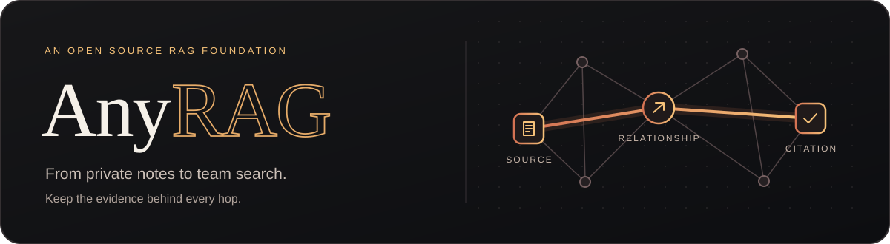
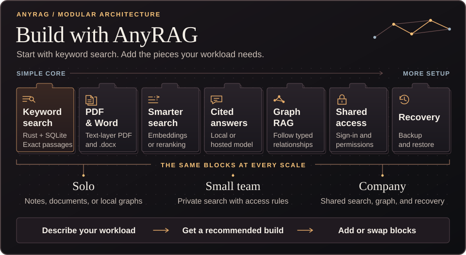
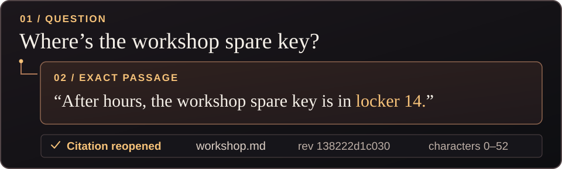
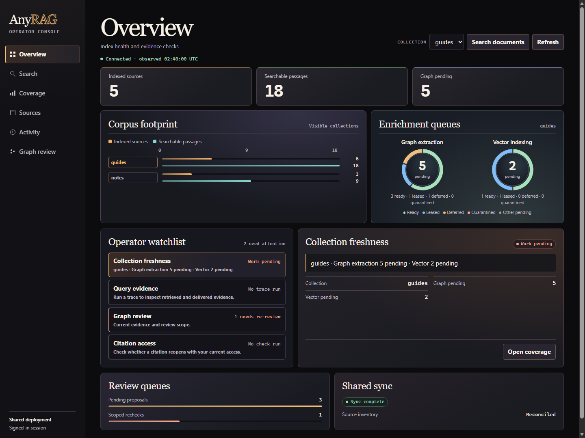

# AnyRAG



**Start with working RAG. Build the version you need.**

Start with a working pipeline that indexes your files, finds relevant passages, and links back to the source. Use it for a folder of notes, then add private team access or Graph RAG when your project calls for it.

## When is RAG worth it?

| If your work looks like this | Start with |
| --- | --- |
| A one-off question about known files, or an exact term your editor can find. | **Open the files or use file search.** Give a model those files directly if you need a summary. |
| Recurring questions across scattered or changing documents, or a need for citations people can reopen and permissions that limit access by collection. | **RAG.** An index finds candidate passages for each question. AnyRAG starts with keyword search. Semantic search and model answers are optional. |
| Answers that depend on a chain, such as which relay a pump requires and which bracket that relay uses. | **Graph RAG.** Declare or review the links, confirm the path, and reopen the evidence for each step. |

Query the source system for live records and exact totals. A whole-collection summary needs a workflow that covers the full collection. An index takes upkeep and can miss evidence. Try a few real questions and compare how long it takes to get a correct, verifiable result. There’s no universal file-count cutoff.

**[Start with your coding agent ↓](#set-it-up-with-an-agent)** · [Manual quickstart](#quickstart-rust-personal-search)

## Choose a setup

[](docs/assets/setup-progression.svg)

| I want to… | Start here |
| --- | --- |
| Search my notes or Obsidian vault | [Index a folder and reopen a citation](docs/setup.md#search-your-own-files). Markdown and text work without a model. |
| Give my team private search | [Index a shared collection and search as a reader](docs/setup.md#search-a-private-team-collection). Collection grants apply to search and citation reads. |
| Trace a relationship across files | [Confirm a guided Graph RAG lookup](docs/setup.md#confirm-a-relationship-across-files). Review the proposed interpretation and open the proof for each step. |

Start with one folder and a question you can check. Add file formats, embeddings, or a model as you need them. [Choose a different combination](docs/field-guide.md#decision-tree)

### Set it up with an agent

Give your coding agent this repo and describe what you need. For example:

```text
Use AnyRAG to search my Obsidian vault. Keep my notes on this laptop
and show me how to reopen a citation.
```

```text
Use AnyRAG to build private Graph RAG for our engineering documents.
We need to trace dependencies across files and restrict who can see them.
```

The agent recommends a build, explains the choices, and walks you to a first cited result. Add or swap pieces as you go. [Agent instructions](AGENTS.md) · [Example setup conversation](docs/agent-setup-example.md)

## See what comes back

[](docs/setup.md#review-sources-and-explain-results)

That citation points to a specific passage and source revision. Sync an edit or deletion and the old citation stops resolving. Shared search checks current access when someone opens a citation. [Try source review](docs/setup.md#review-sources-and-explain-results)

**What if the answer is split across files?** The [Graph RAG demo](docs/architecture.md#run-the-graph-demo) follows `CedarPump → RelayKit → SpareBracket` and shows the quote behind each link.

## What AnyRAG builds for you

- **A searchable document index.** Index a folder of notes and sync it as files change. Enable PDF and Word readers when you need them.
- **Search with citations you can open.** Find exact terms or add search by meaning. Results point to the passage and the source version it came from.
- **Team access, Graph RAG, and recovery.** Add permissions, follow relationships across files, and back up or restore a shared index.

AnyRAG includes the code, deployment recipes, and tests for the work that starts once people rely on search. The tests check that deleted passages disappear, revoked readers lose access even to saved links, and a restored service checks current files and permissions before it serves results again. [Run the same checks](docs/rehearsal.md)

You choose the files, the model if you need one, who gets access, and where it runs. [Explore the architecture](docs/architecture.md)

## What's new in v1.3.0

| Feature | What you can do |
| --- | --- |
| [List the sources you can access](docs/setup.md#list-the-sources-a-reader-can-access) | Page through your exact authorized source inventory from the signed API or MCP. |
| [Sync a company Git mirror](infra/private-vm.md#index-a-company-git-repository) | Index a selected ref at an exact commit and keep citations current through edits and deletions under collection-level grants. Requires a source build and native Git. |
| [Follow Obsidian note links](docs/setup.md#follow-links-in-an-obsidian-vault) | Follow explicit links and reopen their exact source spans without a model. |
| [Cite Word and Excel tables](docs/setup.md#search-an-excel-workbook) | Retrieve a supported table's header, row label, and value with separate citations. Available in the Linux image or a source build. |
| [Search through signed MCP](crates/rust-rag/README.md#guided-relationships-on-a-shared-service) | Give an agent ranked evidence from the reader's current collections. Open an exact citation with the same reader identity. |
| [Search in the shared dashboard](infra/review/README.md#search-authorized-documents) | Find passages and verify their sources from the browser. Use the same sign-in as Graph review. |
| [Check retrieval on your questions](docs/setup.md#check-retrieval-on-your-own-questions) | Check whether your index finds every expected passage. Compare keyword and Graph RAG on the same cases without an answer model. |

See the linked setup for package and build options. Guided lookup runs after an explicit confirmation.

## Live operator dashboard

[](infra/review/README.md)

See what’s indexed and where work is waiting. Follow the watchlist into evidence traces, graph review, and checks that reopen citations under the signed-in user's access.

[Set up the shared console](infra/review/README.md) · [Open a personal dashboard](crates/rust-rag/README.md#local-index-dashboard)

## Quickstart: Rust personal search

[Windows ZIP](docs/setup.md#install-the-windows-zip) · [Linux image](docs/setup.md#try-personal-search-in-the-linux-image) · [Build from source](docs/setup.md#install-from-this-repository) · [v1.3.0 release](https://github.com/skigsy/AnyRAG/releases/tag/v1.3.0)

Start with local Markdown and text search. The default build needs no model or database service.

## Build and deploy

For a team, use the [single-host Linux runbook](infra/private-vm.md). For cloud, start from the [AWS infrastructure reference](infra/aws-deployment.md#deployment-architecture) or adapt the [deployment recipes](infra/README.md) to your provider.

[Architecture and SDK](docs/architecture.md) · [Graph RAG pipeline](docs/architecture.md#full-graph-rag-pipeline) · [Verification](docs/evidence.md) · [Security](SECURITY.md) · [MIT license](LICENSE)
