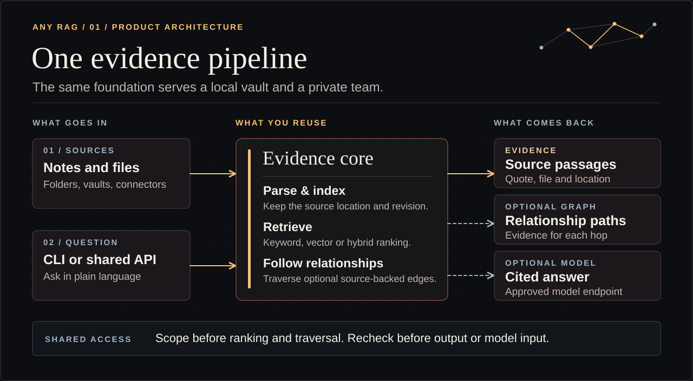
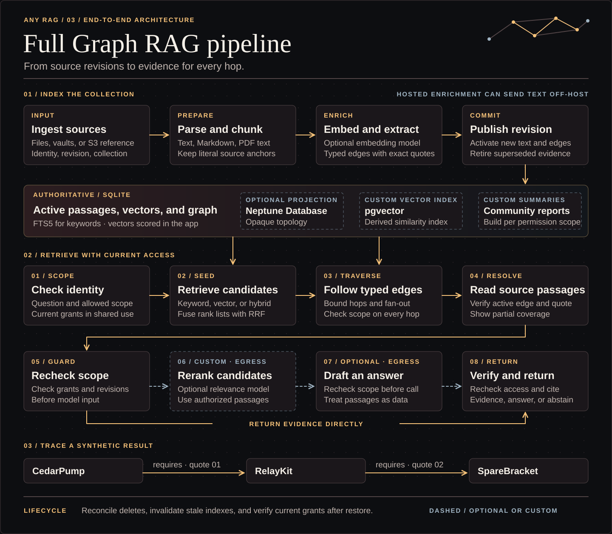

# Architecture and guided installation

Any RAG assembles a local file index, retrieval pipeline, and optional shared service from one Rust workspace. Profiles add independent pieces. Every search returns located source passages, with optional relationship support and an optional model answer.

[Full Graph RAG pipeline](#full-graph-rag-pipeline) · [Architecture choices](rag-reference.md) · [Private AWS deployment diagram](../infra/aws-deployment.md#deployment-architecture)

## One core, several assemblies

~~~mermaid
flowchart LR
  F[Local files or a trusted connector] --> I[Parse, chunk and publish source revisions]
  I --> S[(SQLite evidence and retrieval indexes)]
  I --> G[Optional typed graph]
  G -. Optional projection .-> N[(Neptune)]
  Q[Shared API query] --> A[Verify identity and current policy]
  P[Owner-local query] --> R[Retrieve and rank source evidence]
  A --> R
  S --> R
  G --> R
  N -. Validate active references in SQLite .-> R
  R --> E[Located passages and graph support]
  E --> M[Optional model answer with citations]
~~~

Local mode opens an owner-private index. Shared mode isolates trusted collections in separate stores and selects allowed stores before ranking or traversing relationships. A relationship whose second hop is in another collection is intentionally not traversed by the native shared implementation, even if a reader may search both collections. Design a collection around the graph and access rules you need, or add a scoped multi-store traversal at the shared boundary. Grants are independent of the index and are checked before returning evidence or sending model input. See [verification status](../status.md) for the exact exercised profile.

## Source and evidence lifecycle

Ingestion uses stable source identities and a content hash per revision. Replacement publishes text and retires stale vectors and graph edges together. Slow external model work happens separately and must recheck the active chunk and model configuration before committing. A complete scan can retire missing sources; a failed or incomplete scan cannot. A file found but unreadable keeps its previous indexed revision. Retiring evidence does not delete original files. Backup, export, physical storage and derived indexes have separate deletion rules.

A passage carries a source and chunk ID, path, source revision hash, quote, page (where relevant), and character offsets. Retrieval scores are for ranking. Graph matches add assertions and supporting chunk IDs. Use the anchor and exact source before making an answer claim.

## Using the Rust SDK as an application foundation

Use a path or Git dependency on the workspace crate. The Cargo package is `rust-rag` and the library is `rust_rag`. The SDK works directly with an owner-local index. For collection access use the authenticated HTTP service.

~~~rust
use rust_rag::{Index, RetrievalMode};
use std::path::Path;

fn main() -> anyhow::Result<()> {
    let mut index = Index::open(Path::new("/path/to/private/index"), true)?;
    index.ingest_folder(Path::new("/path/to/notes"), false)?;
    let result = index.query("Which notes mention cold storage?", 5, false, RetrievalMode::Lexical, None)?;
    println!("{result}");
    Ok(())
}
~~~

Use the Any RAG executable for PDF worker isolation. A custom embedding adapter can implement `rust_rag::Embedder` with the `model` feature. Use a different fingerprint and fresh embedding index when changing model, preprocessing, or dimensions. Always apply permissions before choosing which documents to embed or retrieve in a shared application.

## Full Graph RAG pipeline

1. Read and hash the source, parse it within format bounds, and publish an active revision with exact locations.
2. Select chunks for a configured extractor. The standard prose extractor asks a model for relationship type and direction, which it can get wrong even with an exact quote. The [owner-local source-first option](setup.md#opt-into-source-first-extraction) derives them from a declared clause and asks a loopback model to check the names and factual context. The index checks permitted types and requires a unique exact quote containing two distinct entities. It corrects reversed roles when supported clause wording establishes the direction. Existing edges keep their stored tuple and ID and can report a source contradiction until re-extraction. The first extraction with the new fingerprint rebuilds the graph, including proposals and reviewed links, so schedule it before relying on those links. See [when to re-review graph links](../infra/private-vm.md#re-review-graph-links-after-an-extractor-change).
3. Publish assertions only if the source chunk and extractor fingerprint are still active. An unanchored assertion or obsolete result publishes nothing.
4. Retrieve lexical, vector, or hybrid seed passages. Prefer an exact named entity in a cited assertion. A bounded catalog lookup can recover an explicit identifier from active assertions when ranked candidates miss it. Fall back to lexical coverage when there is no exact anchor. Follow bounded typed paths and resolve every result to active source evidence within scope.
5. Return evidence, including partial graph coverage. An optional answer model may cite only the supplied candidate passages. Validate its citations and check the claims against the actual passages.

### Run the graph demo

From the checkout, run the demo to see keyword search miss an indirect dependency that graph retrieval finds.

~~~sh
cargo run --locked --release --features model -- demo
~~~

The demo uses deterministic fixture assertions, validates removal, and makes no model calls.

## Graph RAG levels

| Need | Starting point |
| --- | --- |
| Follow explicit links in notes | Integrate a link adapter that resolves local paths and preserves the link location. |
| Find named relationships across passages | Use the native typed extractor and local SQLite graph. |
| Use a private managed topology service | Use the AWS reference and optional Neptune projection when qualified for the deployment. SQLite still owns evidence and authorization. |
| Discover themes across a large corpus | Add community detection and hierarchy or summary artifacts with source, scope, and freshness. |
| Mix relationship search with structured records | Compose the graph with a scoped query tool. Cite each source and be explicit about its freshness. |

## Choosing a composition

Work through the [decision tree](field-guide.md#decision-tree). Choose retrieval by question type, storage by volume and update patterns, and identity by the real access rules. Then choose where parsing, embedding, extraction, reranking, and answers are allowed to run. In-process embeddings don't make a hosted harness or answer model private. Use the [reference](rag-reference.md) for the pros and cons and the [deployment recipes](../infra/README.md) for concrete examples.

## User-facing installation flow

1. Ask for an example question, approximate collection size and formats, access rules, and deployment constraints if they change the setup.
2. Show a recommended and a custom route. Explain what stays on the machine, what goes to a service, and what the user must supply.
3. Use [setup](setup.md) and `rust-rag plan <profile>` to turn the choice into commands. Use synthetic inputs for the first verification. Evaluation is optional.
4. Record the selected sources, components, locations, permissions, and rollback steps in private configuration or an operator runbook.

A clean no-model install should be able to show the first located evidence before introducing providers or infrastructure.
