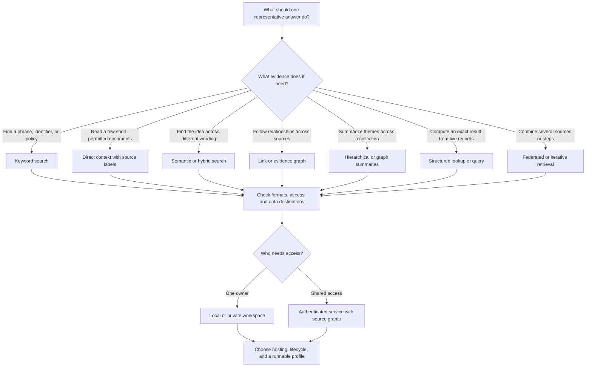

# Choose a RAG setup

Start with one question someone needs answered, the source that can answer it, and who may read that source. These three facts tell you more about the right setup than the size of the model or the number of files. [Architecture reference](rag-reference.md) · [Installation and operation](setup.md) · [Verified configurations](../status.md)

## Start here

| A question like this | Recipe and evidence | First check on your workload |
| --- | --- | --- |
| “Where did I write down error code E104?” | **Keyword search.** The bundled SQLite index is verified for local Markdown and text. It needs no model, GPU, or per-query API. Use `rust-rag plan personal --json`, then the [text quickstart](../README.md#quickstart-rust-personal-search) or [Obsidian recipe](#personal-obsidian-recipe). | Reopen the note from the citation. Try similar identifiers, especially ones distinguished by punctuation, and check what changes after a sync. |
| “Where do we explain what happens when a pump loses pressure?” | **Vector or hybrid search.** Pinned BGE and ONNX are verified in the documented local profile. Hybrid keeps lexical evidence for codes and names. Local embeddings use CPU, model files and vector storage. An embedding API adds network latency, fees and text egress. Use `rust-rag plan semantic --json` and the [embedding recipe](setup.md#local-semantic-search). | Compare keyword and hybrid at the same result limit on both paraphrases and exact IDs. Check latency at your update and query volumes before changing the model. |
| “Which escalation procedure can this employee read?” | **Private team search.** Use `rust-rag plan shared --json`, then the [synthetic shared rehearsal](setup.md#rehearse-private-graph-rag-with-synthetic-sources). Map the real source access policy before deployment. | Try two identities. Revoke one identity and verify that both search and an already saved citation respect the change. |
| “Which controller depends on the relay that uses this part?” | **Typed Graph RAG.** Use `rust-rag plan graph --json` and the [local graph setup](setup.md#local-graph-for-declared-relationships) for explicit relationships. The [source-first option](setup.md#opt-into-source-first-extraction) stages directed links from declared clauses for operator confirmation. For a team, use `rust-rag plan company --json` and the [company rehearsal](setup.md#rehearse-a-cited-company-answer-on-linux). | Compare graph off and on at the same limit. Reopen each active citation and check the subject, relationship and object in order. Test a changed or removed hop. |
| “Which assemblies would stop working if this relay failed, as described across maintenance bulletins?” | **Graph extraction from broader prose.** The existing [chat endpoint interface](../infra/model-endpoint.example.json) accepts a stronger local model or an approved HTTPS provider. Both are workload-specific options. A local model needs more memory and extraction time. A hosted extractor receives eligible passages, adds network and token costs, and needs destination approval. | Use a fresh set of positive and negative clauses. Compare exact directed paths, false edges and useful abstentions. Keep hybrid search or explicit record links if a model cannot pass. |
| “What risks recur across these 300 reports?” | **Hierarchical or community summaries.** Use a [custom summary pipeline](rag-reference.md#when-a-workload-needs-an-adapter) for questions that need the whole collection. | Check that the summary covers the permitted set and can point to sources for each theme. |
| “What is the current inspection status of pump P104, and which work order changed it?” | **Structured lookup plus explicit links.** Use a read-only query or API against the authoritative records. `rust-rag plan custom --json` and the [integration guide](rag-reference.md#structured-records-and-federated-retrieval) help plan the adapter. Its schema, join rules, permissions and endpoint costs depend on the source. | Return the exact value, unit or date and record version. Check missing or duplicate IDs and use the source's permissions for linked records. |
| “Which value is under the ‘inspection interval’ column in this scan?” | **Layout-aware parsing first.** Use [text-layer PDF ingestion](setup.md#choose-your-setup) when the text layer preserves the evidence. The scanned-table OCR worker is experimental. A [custom parser](rag-reference.md#when-a-workload-needs-an-adapter) can handle layouts outside that path. | Compare the exact text, row, and header against the page image before relying on an answer. |

If you do not have the CLI yet, follow [installation](setup.md#install-from-this-repository). Run `rust-rag capabilities --json` to see what your build includes. A feature can compile without its model, permissions, or deployment being ready. Check the [verification status](../status.md) for the exact combination.

Choose retrieval and access separately. A shared team can start with keyword search, and a single owner can use graph traversal. If the source grants access to individual documents or records, check whether your collection layout can express those rules. When it cannot, plan a source-native authorization integration before indexing private material.

## Decision tree

Start with the bundled Rust text index for single-owner Markdown or plain text. Enable PDF or Word readers, semantic search, graph, shared serving, and cloud adapters as needed. Run the matching profile with `rust-rag plan <profile> --json`. Check [setup](setup.md) and [status](../status.md) for the exact feature flags and qualification.

Workload size changes ingestion, serving, and storage needs. The questions determine whether retrieval needs a graph. A developer may explicitly choose a different configuration. Ask only for information that changes the build, such as how often sources change, whether restricted groups share the index, and whether an external model may see passages.

When the fit is unclear, ask for one question and an example of the page or record that answers it. Check that the parser preserves the value and its context. Then try keyword search or a direct record lookup. If the right passage is missing, test hybrid for wording differences or graph for a missing relationship. If the source format, permissions, machine budget, or data policy is unknown, give a conditional starting recipe and name the next check that would change it.

For each build, record the representative question and expected evidence, selected components, access boundaries, where content and derived data travel, and the first runnable result. Name the repo components that fit and any missing integration. **Available** means a verified path under documented conditions. **Experimental** means an opt-in path with unresolved qualification. **Unqualified** means implementation or a deployment recipe exists but the named environment still needs verification. **Custom** means you supply or extend an integration. [Current status](../status.md)

## Decide what to add

1. **Read the source before tuning the search.** If a value, section heading, or link never made it into the index, fix the parser or connector. If the query needs an exact calculation or the current status of a record, query the source directly.
2. **Check whether the evidence makes the candidate list.** Start with keyword retrieval. Add embeddings for different wording, and combine the two if the workload needs both. If an essential passage is across a real relationship, try graph traversal with a citation at each hop.
3. **Check where a good candidate ranks.** If search already retrieves the right passage but ranks a near match above it, try a bounded reranker. Compare on the same candidate set and keep exact identifiers and timeout fallback in the test.
4. **Choose identity and processing destinations before sharing.** Decide who can search and open saved citations, which process can see passages, and what happens after a grant changes. A local index and local embeddings can still feed a hosted assistant.
5. **Choose a storage or hosting change for a measured need.** Use the bundled store first for a supported local or bounded shared setup. Compare other stores when filters, write rate, capacity, or existing operations justify the change. [Storage choices](rag-reference.md#storage-and-indexing-options) · [Deployment targets](../infra/README.md#deployment-targets)

Keep a few representative questions and expected passages. Check the first useful answer, one edit or deletion, and one denied read where access matters. Follow the [local source review](setup.md#review-sources-and-explain-results) to see which files were indexed, why a result appeared, and whether you can still open its exact citation. For comparisons across builds, use the [stage checks and examples](rag-reference.md#evaluate-the-failing-stage).

## Configuration dictionary

| Dimension | Terms and choices | How to decide |
| --- | --- | --- |
| **Source and connector** | Local folder, note vault, object store, drive, wiki, email, ticketing, database, live API, event stream | Choose snapshots for stable libraries and source-native incremental sync for changing data. Record durable source identity, revision, access mapping, and deletion semantics. |
| **Parsing and modality** | Text, text-layer PDF, Word main body, OCR, spreadsheet extraction, image and audio understanding | Use built-in PDF page and Word paragraph or table anchors for supported files. Use OCR or a multimodal parser for information absent from the text layer. Treat extracted content as untrusted data. |
| **Chunking and enrichment** | Fixed windows, headings, structure-aware or semantic splitting, parent-child chunks, metadata, entities | Keep enough context for a citation to make sense. Use smaller chunks for precision and parent context for explanation. Version changes that require a rebuild. |
| **Index and updates** | On-demand lookup, lexical postings, dense vector index, graph index, materialized summaries, batch rebuild, incremental ingestion | Choose by update rate, access rules, and measured latency. Publish complete revisions. Propagate deletes to derived stores. Rebuild vector indexes when model fingerprints change. |
| **Vector storage** | SQLite with exact scoring in the app, PostgreSQL and pgvector, vector services, hybrid search engines | SQLite ships. Choose pgvector as a custom integration for relational joins or managed PostgreSQL. Check filtered ANN recall and scope isolation before relying on a shared index. [Comparison](rag-reference.md#storage-and-indexing-options) |
| **Lexical, semantic, and hybrid** | Keyword search for exact terms, dense embeddings for meaning, hybrid fusion to combine ranked results | Try the representative query. IDs and clauses often benefit from exact matching. Paraphrases may need semantic retrieval. Restrict candidates before ranking and avoid cross-scope score leakage. |
| **Search refinements** | Metadata filtering, query rewriting or decomposition, reranking, context expansion | Add the step that addresses a demonstrated failure. Preserve the original query where useful. Set limits on candidate size, calls, and latency. Apply access rules before reranking or sending context elsewhere. |
| **Graph retrieval** | Explicit links, entity co-occurrence, typed evidence-backed assertions, bounded multi-hop traversal, community or global summaries | Use links for a documented link structure, typed assertions for supported relationships, and summaries for collection-wide questions. Keep an anchor per assertion and authorize every hop. Co-occurrence only indicates shared mentions. |
| **Structured and federated retrieval** | SQL or structured filters, API tools, query routing, federated search, iterative retrieval | Use an authoritative structured source for exact counts or current records. Apply least privilege and bind query parameters. When combining sources, keep permissions, provenance, time, and uncertainty visible per result. |
| **Model and egress** | No answer model, local inference, approved hosted API, separate embedding, extraction, reranking and answer models | Choose where each step runs and what it can receive. A hosted assistant can receive passages even if the index and embeddings are local. Restrict shared services to administrator-approved destinations. |
| **Answers and agents** | Located evidence, cited answers, abstention, bounded tool use, workflows that query several sources | Keep evidence IDs and verify cited IDs against allowed passages. Treat instructions in documents as untrusted. Give tools explicit scopes and let the system state when the evidence is insufficient. |
| **Identity and permissions** | Owner-local, organization with collections, document ACLs, tenant isolation, attribute-based policy | Match the source's real access rules. Check eligibility before ranking, graph expansion, and model dispatch. Test permission changes and use isolated stores where the required boundary calls for them. |
| **Serving and scale** | CLI or SDK, single shared service, scheduled or queued ingestion, exact vector search, approximate nearest neighbor index, replicas or partitions | Estimate documents, chunks, update rate, concurrent queries, and latency budget. Start with a measurable baseline. Add indexing or distributed infrastructure when the workload requires it. |
| **Deployment and operations** | Native local, container on a private host, cloud profile, managed stores, backups, observability, recovery | Match network boundaries, identity, recovery goals, and budget. Keep secrets outside profiles. Define what gets retained, what deletion affects, and what must reconcile before a restored service opens. |
| **Verification** | Smoke checks, retrieval recall, evidence and answer review, isolation canaries, capacity and restore probes | Test the risks and support claims for the chosen composition. Measure using realistic source formats and access scopes. Maintainer checks establish support. Adopters can use custom choices without running an evaluation. |

When a requested term is missing, map it to the dimension it changes. Describe its input and output, permissions, state, dependencies, and failure behavior. Check its compatibility with the other choices and label it **Custom** until there is a runnable integration. For example, a new embedding service changes model and index compatibility. It does not require changing the graph store or deployment target.

## Personal Obsidian recipe

For local keyword search, use [`rust-rag`](../crates/rust-rag/README.md). Select the vault or a notes subfolder and use a dedicated, unsynced index. The Rust scanner skips `.obsidian`, `.git`, `.trash`, and Windows cloud placeholders. Links and embeds inside a note are read as Markdown text. Traversing resolved note links or backlinks uses a separate link graph adapter. [Obsidian data storage](https://obsidian.md/help/data-storage) · [Obsidian note deletion](https://obsidian.md/help/manage-notes)

The [Rust quickstart](../README.md#quickstart-rust-personal-search) shows the first run. To apply it to a vault, initialize a new `--state-dir` and pass the selected local notes folder to `rust-rag ingest`. Repeat ingestion to pick up changes. Use `--sync` when you also want missing paths retired from the index.

For PDFs, install with the PDF feature, initialize an advanced index and use `--pdf` at ingestion. For meaning-based ranking, follow the [local semantic setup](setup.md#local-semantic-search). A hosted harness can receive paths and passages even when the vault and index are local.

On Linux, run from the checkout with an installed `rust-rag`. Set `notes` to the vault or the folder you want to search and choose a state directory outside sync storage.

~~~sh
state="$HOME/.local/state/rust-rag/obsidian"
notes="/path/to/vault"
rust-rag --state-dir "$state" init --profile infra/obsidian.profile.json
rust-rag --state-dir "$state" doctor --json
rust-rag --state-dir "$state" ingest "$notes" --json
rust-rag --state-dir "$state" query "What did I decide about the workshop layout?" --json
~~~

On Windows, set the same inputs in PowerShell.

~~~powershell
$state = Join-Path $env:LOCALAPPDATA 'RustRAG-Obsidian'
$notes = 'C:\path\to\vault\Notes'
rust-rag --state-dir "$state" init --profile infra/obsidian.profile.json
rust-rag --state-dir "$state" doctor --json
rust-rag --state-dir "$state" ingest "$notes" --json
rust-rag --state-dir "$state" query "What did I decide about the workshop layout?" --json
~~~

Compare the returned `text` with the source at its `start` and `end` character offsets. Use the same selected folder for later updates. Re-ingest after an edit and verify the new quote and revision. Add `--sync` after a deletion to retire missing notes from the index, then confirm a query for a unique term in the deleted note returns no evidence. Use `rust-rag --state-dir "$state" remove --all --json` to clear indexed evidence while keeping the notes.

## Example compositions

| Need | Configuration | Status |
| --- | --- | --- |
| Find a term in your Markdown or text notes | Rust `rust-rag`, bundled SQLite, source passages | [Rust personal](../crates/rust-rag/README.md). Platform and build verification are listed there. |
| Search personal notes and PDFs by name or meaning | Folder or Obsidian notes, lexical or local embeddings, SQLite, local assistant, optional typed graph | Available via the [Obsidian recipe](#personal-obsidian-recipe) or [local semantic setup](setup.md#local-semantic-search). |
| Share procedure lookup with a department | Approved collection, incremental ingest, lexical or hybrid, authenticated shared service, collection grants | See the [shared profile](../infra/shared.profile.example.json) and [qualification](../status.md). |
| Trace a project's dependency chain for a few dozen users | Typed assertions, permission-aware graph traversal, citations, portable service, AWS with optional Neptune | Local typed graph and native shared service available. The [AWS and Neptune reference](../infra/aws-deployment.md) is **Unqualified**. |
| Search a large enterprise with dynamic document permissions | Source-native identity and ACL connector, scoped lexical and vector search, tenant or corpus isolation, audited revocation and recovery | Custom. Start at the [connector and authorization boundary](rag-reference.md#when-a-workload-needs-an-adapter). |
| Search procedures alongside an existing PostgreSQL application | pgvector, metadata joins, scoped exact baseline, optional approximate index and reranker | Custom. [PostgreSQL integration and tradeoffs](rag-reference.md#postgresql-with-pgvector). |
| Scale vector search separately from evidence storage | Rebuildable Qdrant projection with scoped candidate filters and current citation resolution | Custom. [SQLite, pgvector, and Qdrant comparison](rag-reference.md#sqlite-pgvector-or-qdrant). |
| Let operations staff edit a multi-step approval or lookup flow | Visual workflow over the authenticated retrieval service | Custom. [Visual orchestration and identity boundary](rag-reference.md#when-a-workload-needs-an-adapter). |
| Combine scanned PDFs, live metrics and linked records | OCR or multimodal parser, authorized structured query tool, federated retriever, evidence per source | Custom. Qualify the parser, tool authorization, and combined evidence contract. |

For the agent entry point, see [operating instructions](../AGENTS.md#build-and-installation-requests). For the company implementation sequence, see [reference build](project/plan.md#company-graph-rag-reference-build).
