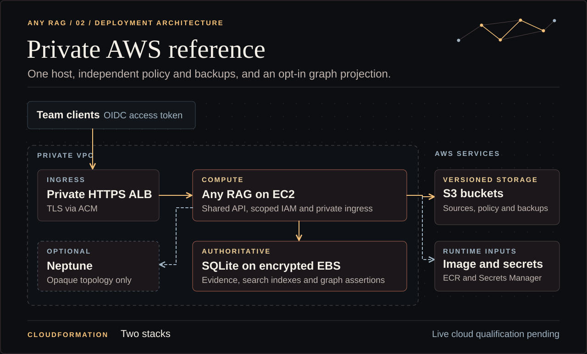

# Private AWS reference profile

The Any RAG reference uses one EC2 host, an encrypted attached EBS volume, a private HTTPS load balancer, and versioned S3 source, backup, and policy stores. SQLite is authoritative for evidence and typed assertions. The optional Neptune mode adds a private, encrypted projection. Treat this as a single-organization, single-host profile with an explicit recovery procedure. Live deployment and capacity evidence must match the chosen region, network, image, and models. [Neptune private access](https://docs.aws.amazon.com/neptune/latest/userguide/security-vpc.html)

## Deployment architecture

[](../docs/assets/aws-reference-architecture.svg)

## Before creating a change set

- Select an authorized account and region, a VPC with at least two private subnets in distinct Availability Zones, the host subnet and its zone, an ACM certificate, and the private client network. The host needs approved HTTPS routes to the AMI package repositories, ECR, S3, Secrets Manager, the IdP, and any chosen model endpoint. Provide private DNS for the TLS listener. The listener connects to the application over HTTP within the private application security group.
- Select a Nitro x86-64 host and approved Amazon Linux 2023 AMI with AWS CLI v2 and a `/dev/xvda` root mapping. Bootstrap uses `jq` to assemble the protected profile. The launch template requires IMDSv2. The Rust SDK uses the instance role and the application uses host networking so the hop limit can stay at one. The template opens no SSH ingress. Set up a separate authorized operator access route if required. [Docker on Amazon Linux 2023](https://docs.aws.amazon.com/AmazonECS/latest/developerguide/create-container-image.html) · [EC2 metadata options](https://docs.aws.amazon.com/AWSEC2/latest/UserGuide/configuring-instance-metadata-options.html)
- Build the [portable image](private-vm.md#build-an-image) with the Rust `aws` feature, record its digest, and make that exact digest available in an approved private ECR repository in this account and region. The template permits pulls from that repository. The image build uses no credentials from the app profile.
- Review storage size, instance and load balancer cost, S3 request and retention cost, model egress, and the optional Neptune instance and snapshots. Use `EnableNeptune=false` for the base profile. Verify the change set contains only the expected private resources and retained state.

```sh
docker build --build-arg WITH_AWS=1 --tag rust-rag:aws .
docker run --rm --network none rust-rag:aws capabilities --json
```

Check that `compiled.aws_adapters` is true in the capabilities output before publishing that image to the approved ECR repository.

## Storage and policy

Review [aws-storage.yml](aws-storage.yml) first. It supplies separate retained buckets for source documents, recovery snapshots, and current access policy. It enables versioning, encryption, TLS-only requests, and public access blocks. The policy bucket protects versions with Object Lock governance retention. Give its writer role to the policy administrator and keep bypass, overwrite of historical versions, and deletion out of service and backup roles. Restrict policy writer changes to the approved current manifest. Object Lock protects retained versions. Administrator control of the latest version establishes which policy is current. [S3 version protection](https://docs.aws.amazon.com/AmazonS3/latest/userguide/object-lock.html)

Publish a trusted policy JSON object at `PolicyKey` in the policy bucket with a new `version` on every change. Use the [policy example](private-vm.md#prepare-trusted-inputs) to assign IdP subjects and roles to collections. Store approved source documents in disjoint collection prefixes within `SourcePrefix`. Source versions must be real S3 version IDs. A document access grant belongs to its configured collection. If source IAM permissions differ inside a collection, partition documents into corresponding approved collections before importing them.

The connector pages through object versions and fetches the exact active version. Delete markers remove objects from the inventory. The service compares a second complete listing before pruning missing entries. Inventory capacity includes historical versions and delete markers. An incomplete, over-budget, or inconsistent inventory blocks pruning. The policy reader compares the current bytes against the exact protected S3 version and rechecks that version before granting access. [S3 version listing](https://docs.aws.amazon.com/AmazonS3/latest/API/API_ListObjectVersions.html)

## Service inputs and plan

Copy [the profile example](aws.profile.example.json) to a protected file outside the checkout, set trusted issuer, audience, JWKS, source collection names and non-overlapping prefixes, and save it as a Secrets Manager string. Use the object ARN as `ProfileSecretArn`. The host binds source, policy, backup, and state locations to the stack inputs. It explicitly enables HTTP on the private upstream listener behind the load balancer's TLS and security-group boundary. The profile should contain references to credentials, such as `api_key_file` pointing at `/run/rust-rag/config/model-key`. Supply that credential through `ModelKeySecretArn` when using this reference. The host mounts configuration from `/run` read-only and keeps secret values out of instance user data and image layers. For customer-managed KMS keys, scope the role and key policy to `kms:Decrypt` for secrets and the documented `kms:Decrypt` and `kms:GenerateDataKey` permissions for SSE-KMS source reads. [S3 object read permissions](https://docs.aws.amazon.com/AmazonS3/latest/API/API_GetObject.html)

Locally inspect both templates before requesting an account change set.

```sh
cfn-lint infra/aws-storage.yml infra/aws.yml
```

### Example qualification budget

For an eight-hour synthetic replay in `us-east-1`, use the default `t3.medium`, 16 GiB root and 32 GiB evidence volumes, and one internal ALB with a planning allowance of one LCU. This example assumes an existing approved private network, TLS certificate, and routes to the required services. Set `EnableNeptune=false` for the first replay.

| Meter | Planning basis | Eight-hour estimate |
| --- | --- | ---: |
| EC2 | One Linux `t3.medium` at $0.0418/hour. [EC2 T3 pricing](https://aws.amazon.com/ec2/instance-types/t3/) | $0.33 |
| Internal ALB | $0.0225/hour plus $0.008 per LCU-hour. [ELB pricing](https://aws.amazon.com/elasticloadbalancing/pricing/) | $0.24 |
| EBS | 48 GiB of gp3 at an assumed $0.08 per provisioned GB-month, using a 30-day month. [EBS pricing](https://aws.amazon.com/ebs/pricing/) | $0.04 |

The unrounded subtotal is about $0.62. Before authorization, price the selected model and issuer, S3 versions and requests, ECR, Secrets Manager, network transfer and endpoints, surplus CPU credits, and retained volumes or backups. Confirm rates for the actual region, set budget alerts, and agree on a teardown deadline and a tested rollback image digest. The estimate covers a short functional replay. Its workload does not establish production sizing. [S3 pricing](https://aws.amazon.com/s3/pricing/) · [ECR pricing](https://aws.amazon.com/ecr/pricing/) · [Secrets Manager pricing](https://aws.amazon.com/secrets-manager/pricing/) · [VPC pricing](https://aws.amazon.com/vpc/pricing/) · [AWS Budgets](https://docs.aws.amazon.com/cost-management/latest/userguide/budgets-managing-costs.html)

### Prepare change sets

Use CloudFormation change sets for the storage and service stacks. The following commands create reviewable change sets in a separately authorized sandbox. Supply AWS CLI parameter JSON for `infra/aws.yml` in the protected file indicated by `RUST_RAG_AWS_PARAMETERS` (an array of `ParameterKey` and `ParameterValue` objects). Seed sources and access policy after the storage change set is approved and applied. Review each change set before executing it.

```sh
aws cloudformation create-change-set --stack-name rust-rag-storage \
  --change-set-name initial-storage --change-set-type CREATE \
  --template-body file://infra/aws-storage.yml
aws cloudformation describe-change-set --stack-name rust-rag-storage --change-set-name initial-storage

aws cloudformation create-change-set --stack-name rust-rag-service \
  --change-set-name initial-service --change-set-type CREATE --capabilities CAPABILITY_IAM \
  --template-body file://infra/aws.yml --parameters "file://$RUST_RAG_AWS_PARAMETERS"
aws cloudformation describe-change-set --stack-name rust-rag-service --change-set-name initial-service
```

Set the client DNS name covered by the ACM certificate to the private load balancer. Verify target health after bootstrap. Check the service over the approved private network, using an access token from the configured issuer. Keep the token out of command-line arguments and logs.

Treat the service template as an initial-bootstrap and replacement blueprint. EC2 shell user data runs on the first launch. Changing `ImageDigest`, `ProfileSecretArn`, or `EnableNeptune` on the existing stack can leave the original bootstrap configuration running. For those changes, plan an approved replacement deployment and the backup/reconciliation procedure below. Verify the digest and effective graph mode on the replacement host before switching DNS. Restarting the service rereads the current secret value from the existing configured ARN. [EC2 user data lifecycle](https://docs.aws.amazon.com/AWSEC2/latest/UserGuide/user-data.html)

## Lifecycle and recovery

The following commands expect `RUST_RAG_URL` to be the trusted private HTTPS service URL and `RUST_RAG_TOKEN` to be a valid token already obtained from the configured IdP. Use an administrator token for maintenance calls and the intended reader's token for retrieval.

```sh
rust_rag_request() {
  method=$1
  path=$2
  shift 2
  curl --silent --show-error --fail-with-body --config - \
    --request "$method" "$RUST_RAG_URL$path" "$@" <<EOF
header = "Authorization: Bearer $RUST_RAG_TOKEN"
EOF
}
rust_rag_request POST /v1/admin/sync
rust_rag_request GET /v1/admin/status
```

Wait for a complete inventory reconciliation. Review the source and policy, then reopen if the service reports maintenance mode. Use a permitted reader token for the query, and repeat with a reader lacking the source grant. Exercise collection revocation, source replacement, and an S3 delete marker followed by synchronization.

```sh
rust_rag_request POST /v1/admin/reopen
rust_rag_request POST /v1/query --json '{"question":"What does the synthetic note say?","mode":"lexical"}'
```

Set a backup interval based on your recovery point target. Invoke `POST /v1/admin/backup` with an authorized administrator identity and record the returned `backup_id` outside runtime state. The service writes consistent SQLite snapshots as unique encrypted S3 objects and publishes the bundle manifest last. Restores check the SHA-256 checksum on every transferred object. Control S3 retention and periodically verify a real restore. Schedule API calls through your existing protected scheduler if desired.

```sh
rust_rag_request POST /v1/admin/backup
```

To restore an approved backup, use the same deployment binding with the protected current policy store, then keep reads closed until source reconciliation and review complete. A failed inventory blocks reopening after restore. Record elapsed recovery time against the workload's requirements. During host replacement keep the evidence volume retained. The replacement attaches in the same Availability Zone. Coordinate stopping the old host and moving its volume before a replacement that would overlap attachment. A service-stack deletion retains the evidence volume and storage stack objects. Neptune has deletion protection and a snapshot policy. Review cleanup and retention of each resource before teardown.

```sh
rust_rag_request POST /v1/admin/restore --json '{"backup_id":"replace-with-returned-backup-id"}'
rust_rag_request POST /v1/admin/sync
rust_rag_request GET /v1/admin/status
# After a complete current-policy reconciliation and an operator review:
rust_rag_request POST /v1/admin/reopen
```

## Opt-in Neptune

Set `EnableNeptune=true`, choose an available `NeptuneEngineVersion` supporting custom openCypher IDs, and provide `NeptuneKeySecretArn` containing 64 hexadecimal characters from a secure generator. Keep the key stable per deployment. Configure a named extraction endpoint and grant its use for the approved collections. The host injects the private writer endpoint and a protected key-file reference. This profile runs its own Neptune cluster for one Any RAG deployment. [Neptune custom IDs](https://docs.aws.amazon.com/neptune/latest/userguide/access-graph-opencypher-extensions.html)

The template permits Neptune traffic from the application security group and grants query actions to the instance role. The adapter projects keyed entity, revision, generation, and collection identifiers with opaque edge anchors. SQLite retains assertion predicates, labels, and evidence. The adapter activates a generation only after staging all its edges, then retries bounded cleanup of older generations. Reads use a fixed parameterized query that compares every authorized collection's generation and limits candidates to authorized active revisions before ordering and limiting. A stale or oversized scope yields graph unavailable. The application checks the returned anchors in SQLite before traversing or citing them. Use the writer endpoint for both staging and lookup. [Neptune endpoint roles](https://docs.aws.amazon.com/neptune/latest/userguide/feature-overview-endpoints.html) · [Neptune IAM data resources](https://docs.aws.amazon.com/neptune/latest/userguide/iam-data-resources.html)

After ingest, check admin status. `projection_complete` confirms the current generation is active. `projection_cleanup_complete` reports whether old remote edges and nodes have been deleted. Retry sync when either flag is false. A current generation excludes stale topology while cleanup continues. Snapshot retention is a separate operation. When retiring a collection, revoke it in the current policy and sync with its route still configured to clean up the projection before removing that route. Changing the projection key creates new opaque identities. Plan rotation with a rebuild and an explicit cleanup or replacement of the old dedicated projection. Remote topology and opaque IDs still need the customer's sensitive-data retention controls.
